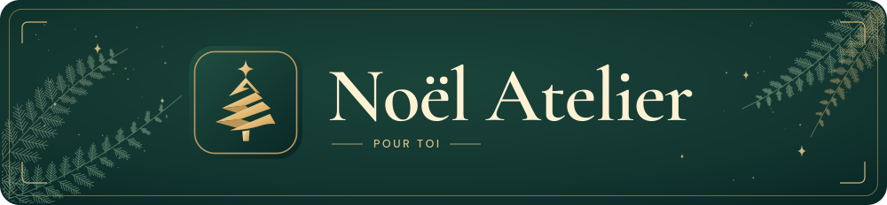

<p align="center"><a href="https://bobo8886.github.io/noel-atelier/?lang=zh"></a></p>

<p align="center"><a href="./README.md">English</a> · <strong>简体中文</strong></p>

<p align="center">亲手拉开缎带，点亮一棵圣诞树，再把心里那句话装进礼物送给一个人。</p>

<p align="center">
  <a href="https://bobo8886.github.io/noel-atelier/?lang=zh"></a>
  &nbsp;
  <a href="https://github.com/bobo8886/noel-atelier/releases/latest/download/noel-atelier-offline.html"></a>
</p>

<p align="center">
  <a href="https://github.com/bobo8886/noel-atelier/releases/latest"></a>
  <a href="./LICENSE"></a>
  <a href="https://github.com/bobo8886/noel-atelier/stargazers"></a>
</p>

## 礼盒里有什么

拉开蝴蝶结，盒盖升起，四面盒壁依次翻开。一棵松树在冬夜的湖畔长成，从树干、松针到金属挂球和绕枝灯串，都由代码绘制。你可以拖动视角绕树看一圈，也可以按住枝头攒一束光，让心愿飞过湖面。最后，今夜的树会成为一张随信附上的照片。

<p align="center"> </p>

## 送给一个人

信纸把日期、称呼和署名各自留出位置，参考了简·奥斯汀的传世信札。中文称呼与署名使用随礼物携带的文楷字形，导出时也会处理标点避头。 [大英图书馆馆藏](https://www.bl.uk/stories/blogs/posts/jane-austen-at-250) · [W3C 中文排版需求](https://www.w3.org/TR/clreq/)

1. 进入礼物，点右上角的信封，填收礼人的名字，写下署名和祝福。点「封好并下载」会得到一份专属 HTML 文件。
2. 把文件作为附件发给对方。收礼人保存后用浏览器打开，离线也能从未拆封的礼盒开始。开场会叫出对方的名字，信纸上会出现你写的话。
3. 点「保存来信」可将树景和信纸一起存为横版 PNG，旁边的小箭头可以选择原有的竖版明信片。点「写一份回礼」可写信、封缄并下载。互动时写下的心愿会留在收礼人自己的信里。

## 四种互动

| 效果 | 鼠标或触屏 | 摄像头手势 |
| --- | --- | --- |
| 星河 | 点「星河」，移动指针或指尖牵引星流。 | 张开手掌，移动手心。 |
| 亮灯 | 点「亮灯」，星光合拢成树，暖灯沿松枝逐层点亮。 | 轻握成拳。 |
| 飘雪 | 点「飘雪」，左右移动可以改变风向。 | 比出 V 字，左右移手。 |
| 许愿 | 按住树身蓄光，松开放飞；点「写下心愿」可以写上自己的话。 | 拇指和食指捏合，停留片刻后松开。 |

键盘可用 **Tab** 选择按钮，**回车** 确认。焦点在树上时，用左右方向键转动视角，按住**空格**蓄光，松开许愿。礼物内可以随时切换简体中文和英语。

## 写在雪夜的曲子

点顶栏「听配乐」可播放或暂停原创曲《灯影落在雪上》。音乐盒奏出四音动机，弦乐接过旋律，在 6/8 拍的 G 大调中走完 24 小节。网页和离线回信用 Web Audio 演奏同一份乐谱，45 秒循环。 [试听录音](https://bobo8886.github.io/noel-atelier/assets/music/lamplight-on-snow.mp3)

## 在线、离线与本地运行

| 版本 | 打开方式 |
| --- | --- |
| 在线体验 | 打开[中文页面](https://bobo8886.github.io/noel-atelier/?lang=zh)或[英文页面](https://bobo8886.github.io/noel-atelier/?lang=en)。鼠标、触屏、键盘可直接玩，也可自选开启摄像头。 |
| 单文件礼物 | 保存[离线 HTML](https://github.com/bobo8886/noel-atelier/releases/latest/download/noel-atelier-offline.html)，双击打开。动画、声音、双语界面、信纸、明信片和回礼都装在这一个文件里。 |
| 完整版 | 下载并解压[完整 ZIP](https://github.com/bobo8886/noel-atelier/releases/latest/download/noel-atelier.zip)，里面有双击可玩的 HTML，以及带本地手势识别模型的源码。 |
| GitHub Packages | 同一份 ZIP 也以 Maven 构件 `io.github.bobo8886:noel-atelier:1.2.0` 发布。免登录下载可用 Releases。 [软件包目录](https://github.com/users/bobo8886/packages?repo_name=noel-atelier) · [发行页](https://github.com/bobo8886/noel-atelier/releases/latest) |

本地运行源码版时，先安装 Node.js。在含有 `server.mjs` 的目录运行以下命令。Windows 也可以双击 `启动圣诞工坊.cmd`。

```sh
node server.mjs
```

打开终端显示的本机地址。拆开礼物后点击「手势互动」，允许浏览器使用摄像头即可。视频画面在设备上处理。单文件版使用鼠标、触屏和键盘。画面优先以 WebGL 渲染，浏览器无法提供 WebGL 时会使用 Canvas 2D。

修改源码后，可用 Node.js 18 或更新版本重新生成单文件。输出位置为 `assets/gift-template.html`，在线版制作个性化礼物时也使用这个模板。

```sh
npm ci
npm run build
```

## 许可与致谢

本项目的原创代码、美术设计、缎带松树标识及《灯影落在雪上》的乐谱与录音使用 MIT 许可。Three.js、MediaPipe、Phosphor Icons、霞鹜文楷、Cormorant Garamond 和 DM Sans 保留各自的许可。 [MIT 许可](./LICENSE) · [第三方声明](./THIRD_PARTY_NOTICES.md)
